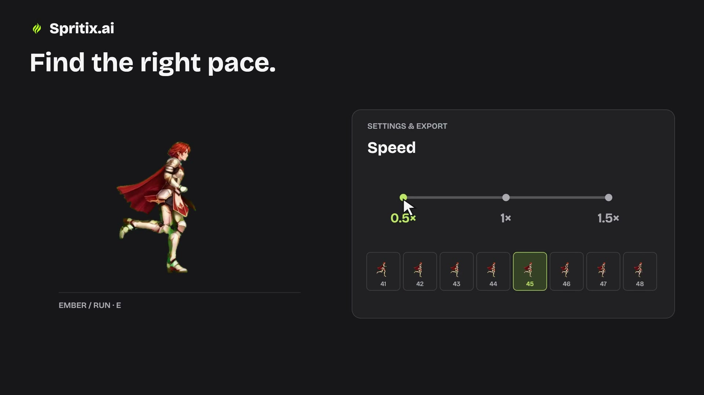

[English](../../README.md) · [简体中文](../../docs/readme/zh.md) · [繁體中文](../../docs/readme/zh-Hant.md) · [日本語](../../docs/readme/ja.md) · [한국어](../../docs/readme/ko.md) · [Português (Brasil)](../../docs/readme/pt-BR.md) · [Français](../../docs/readme/fr.md) · [Deutsch](../../docs/readme/de.md) · [Italiano](../../docs/readme/it.md) · [Español](../../docs/readme/es.md)

# Spritix Showcase

### Sprites com IA e animações de personagens 2D

Transforme um personagem em uma biblioteca de ações. O Spritix é uma ferramenta no navegador para desenvolvedores independentes, participantes de game jams e pequenas equipes de jogos 2D.

**[Conheça o Spritix](https://spritix.ai/pt-BR)** · [Recursos e planos atuais](https://spritix.ai/pt-BR/pricing)

**[Assista à apresentação de 80 segundos](../../showcase/launch/spritix-showcase-80s.mp4)** — Vídeo em inglês · 1920 × 1080 · MP4

## Sobre o Spritix

Use [IA para sprites](https://spritix.ai/pt-BR) para criar animações a partir de uma imagem de corpo inteiro. O [gerador de sprites](https://spritix.ai/pt-BR) oferece ações de espera, caminhada, corrida, salto e ataque. Ajuste o ritmo e os loops e organize os quadros com o [gerador de sprite sheets com IA](https://spritix.ai/pt-BR). O [criador de sprite sheets](https://spritix.ai/pt-BR) exporta sprite sheets, GIFs, Atlas JSON e quadros PNG individuais.

## Como começar

1. Envie uma imagem de corpo inteiro ou descreva um novo personagem.
2. Prepare a referência do personagem e gere uma ação.
3. Confira a animação, ajuste a reprodução e a exportação e baixe os arquivos disponíveis no seu plano.

## Sobre este repositório

Este repositório público reúne demonstrações, estudos de caso e apresentações multilíngues do Spritix. O primeiro exemplo é um vídeo horizontal de 80 segundos. Ele apresenta resultados reais em um vídeo editado, não uma medição do tempo de geração.

[Ver exemplos](../../showcase/README.md) · [Contribuir com um caso ou tradução](../../CONTRIBUTING.md)

## Uso e permissões

Os arquivos são publicados para visualização. Não há uma licença geral para reutilizar ou redistribuir as ilustrações, os vídeos, a música ou a identidade visual apresentados. Consulte o aviso de uso.

[Aviso de uso](../../USAGE.md)
